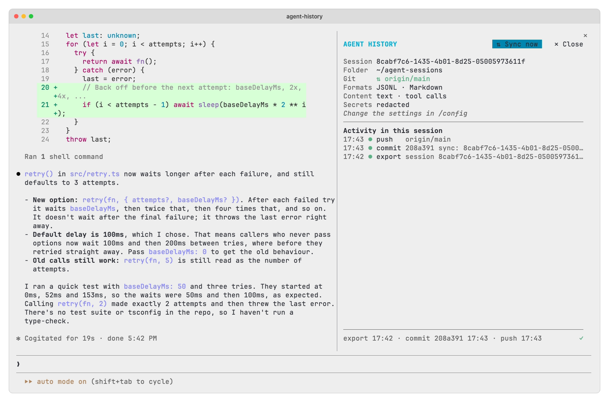

# Agent History for Claude Code

<picture>
  <source media="(prefers-color-scheme: dark)" srcset="../assets/pane-dark.png" />
  
</picture>

This folder is the Claude Code plugin of [Agent History](../README.md). It is a [hooks module](https://code.claude.com/docs/en/plugins/mods/overview) that Claude Code loads itself. After each turn, it exports the session and its subagents to a folder you choose, and commits and pushes it when the folder is a git repository.

## Install

```
/plugin marketplace add zirkelc/agent-plugins
/plugin install agent-history@zirkelc
```

Then open `/config`, search for `agent-history`, and set the export folder. The [README](../README.md) describes the settings, the panel and the files.
